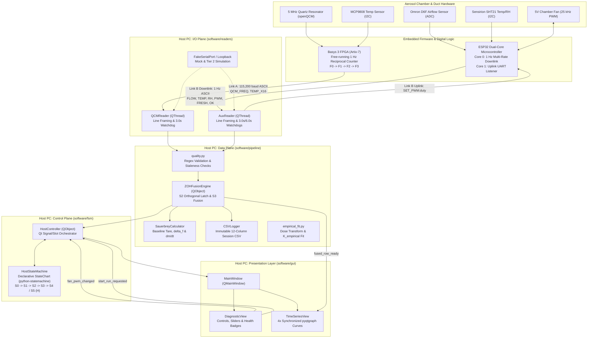

# ECE 490 Capstone Codebase Learning Guide & Architecture Audit

> **Target Repository:** `./` (Repository Root)  
> **Project:** FPGA-Based Resonant Mass Sensing Platform for Ultrafine Particulate Matter Detection ($< 0.25\ \mu\text{m}$)  
> **Author/Maintainer Focus:** Host PC Software & Integration Stack (Lead: Kevin Wu)  
> **Objective:** Comprehensive educational walkthrough, prerequisite roadmap, simplification opportunities, and AI-generation ("vibe-code") risk assessment for academic defense preparation.

---

## 1. Project Overview

### 1.1 What the System Does
The ECE 490 Resonant Mass Sensing Platform is a cyber-physical measurement instrument designed to detect ultrafine aerosol particulate matter ($< 0.25\ \mu\text{m}$) in real time. Standard optical particle counters fail in the sub-$300\text{ nm}$ regime due to Rayleigh scattering drop-off. This system solves that physical limit using an integrating **Quartz Crystal Microbalance (QCM)**: an AT-cut 5 MHz piezoelectric quartz resonator whose resonant frequency decreases linearly with mass deposition according to the classical **Sauerbrey equation**.

To convert raw frequency shifts into calibrated particulate concentrations and mass accumulation rates, the host software integrates three asynchronous data streams:
1. **Link A (Basys 3 FPGA):** Continuous 1 Hz reciprocal counter measurement of the 5 MHz QCM sensor frequency ($f_{\text{qcm}}$) and crystal holder temperature ($T_{\text{qcm}}$ from an MCP9808 I2C sensor).
2. **Link B (ESP32 Microcontroller):** Continuous 1 Hz telemetry reporting sample duct airflow rate ($Q$ via Omron D6F-V03A1 analog flow meter), chamber air temperature and relative humidity ($T_{\text{sht}}, \text{RH}$ via Sensirion SHT21 I2C sensor), active fan PWM duty, and sensor health flags. Link B also accepts bidirectional uplink commands (`SET_PWM:<duty>\n`) to dynamically modulate chamber ventilation.
3. **Reference Instrument (SMPS Calibration):** Offline or live file ingestion from a Scanning Mobility Particle Sizer (TSI SMPS), which provides golden-standard volumetric concentration ($C_{\text{SMPS}}$ in $\mu\text{g/m}^3$) to extract an empirical calibration factor ($K_{\text{empirical}}$) via an integral dose transform.

### 1.2 Technology Stack
* **Language & State Machine:** Python 3.10+ (using strict type hints, `dataclasses`, `enum.Enum`, and `typing.Protocol`); `python-statemachine` 3.2.2 (`statemachine.StateChart`) for declarative UML statecharts.
* **GUI & Visualization:** PyQt6 (`QtWidgets`, `QtCore`, `QtGui`) for GUI layout and signal/slot event routing; `pyqtgraph` for hardware-accelerated 60 FPS multi-waveform plotting.
* **Serial Communications:** `pyserial` managing two independent USB-UART VCP links at 115,200 baud (`8N1`).
* **Data Processing & Analytics:** `numpy` (vectorized math, trapezoidal integration), `pandas` (time-series analysis, SMPS tabular data), `scipy` (least-squares regressions).
* **Testing & Verification:** `pytest` 9.1.1 (all 94 unit and full-stack integration tests passing with 100% pass rate in 3.03s), virtual serial loopback harness (`_BytePipe`, POSIX `pty`, Windows `com0com`), and in-process mock readers.

### 1.3 System Architecture Diagram

---

## 2. How the Project Was Coded: Module-by-Module Walkthrough

To understand the codebase thoroughly, avoid jumping into the GUI first. Follow the recommended **data-to-control reading order**: understand the pure mathematical contracts first, then the control logic, then the worker threading, and finally the GUI orchestration.

---

### Step 1: Wire Contract & Quality Validation — [`quality.py`](software/pipeline/quality.py#L1-L133)
* **Purpose:** Acts as the single source of truth for communication schemas, regex framing, sensor health guards, and timestamp staleness evaluation. It contains zero Qt or serial dependencies, making it completely pure and unit-testable.
* **Key Components:**
  * [`QCM_PATTERN`](software/pipeline/quality.py#L37): Regex `rb"QCM_FREQ=(\d+),TEMP_X16=(-?\d+)"` matching the Basys 3 FPGA ASCII format.
  * [`parse_qcm_line()`](software/pipeline/quality.py#L45-L61): Extracts integer frequency and converts raw 16x fixed-point temperature into degrees Celsius (`temp_c = int(m.group(2)) / 16.0`). Correctly parses negative readings (e.g., `-000080` becomes $-5.0^\circ\text{C}$).
  * [`AUX_PATTERN`](software/pipeline/quality.py#L38-L40): Regex matching Link B telemetry: `FLOW=([\d.]+),TEMP=(-?[\d.]+),RH=([\d.]+),PWM=(\d+),FRESH=([01]),OK=([01])`.
  * [`parse_aux_line()`](software/pipeline/quality.py#L64-L95): Validates that numeric values are finite (`math.isfinite`), PWM duty is within range $[0, 100]$, and flags are booleans. Returns a typed dictionary.
  * [`zoh_age()`](software/pipeline/quality.py#L117-L124): Evaluates sample age. Clamps negative elapsed times to `0.0` to gracefully handle sub-millisecond timestamp jitter between independent reader threads.
* **Data Flow:** Raw bytes from UART buffers $\to$ Regex pattern matching $\to$ Value range & finiteness verification $\to$ Structured Python dictionary / tuple.

---

### Step 2: Resonator Physics & Derivative Engine — [`sauerbrey.py`](software/pipeline/sauerbrey.py#L1-L119)
* **Purpose:** Implements the acoustic gravimetry equations converting resonant frequency shifts into real-time particulate mass deposition ($\Delta m$) and deposition rates ($dm/dt$).
* **Physical Foundations:**
  For an AT-cut quartz crystal, the Sauerbrey mass sensitivity constant $C_{\text{QCM}}$ is given by:
  $$C_{\text{QCM}} = \frac{A \sqrt{\rho_q \mu_q}}{2 f_0^2} \times 10^9 \quad [\text{ng/Hz}]$$
  where:
  * Quartz density $\rho_q = 2.648\text{ g/cm}^3$ ([`QUARTZ_DENSITY_G_CM3`](software/pipeline/sauerbrey.py#L22))
  * Shear modulus $\mu_q = 2.947 \times 10^{11}\text{ g}\cdot\text{cm}^{-1}\cdot\text{s}^{-2}$ ([`QUARTZ_SHEAR_MODULUS_G_CM_S2`](software/pipeline/sauerbrey.py#L23))
  * Active electrode area $A = 0.205\text{ cm}^2$ ([`ELECTRODE_AREA_CM2`](software/pipeline/sauerbrey.py#L24))
  * Fundamental resonant frequency $f_0 \approx 5.0\text{ MHz}$ ([`NOMINAL_F0_HZ`](software/pipeline/sauerbrey.py#L25))
  * Resulting constant: $C_{\text{QCM}} \approx 3.622\text{ ng/Hz}$.
* **Key Class: [`SauerbreyCalculator`](software/pipeline/sauerbrey.py#L51-L119):**
  * [`freeze_baseline(ts, f0_hz, t0_c)`](software/pipeline/sauerbrey.py#L77-L90): Anchors $f_0$ and $T_0$ at the exact transition into streaming (`S2 -> S3`). It calculates $C_{\text{QCM}}$ using the *measured* $f_0$ rather than the ideal nominal value, ensuring numerical consistency.
  * [`compute(ts, freq_hz)`](software/pipeline/sauerbrey.py#L92-L119): Computes frequency shift $\Delta f = f_k - f_0$. It evaluates the backwards difference derivative $df/dt = (\Delta f_k - \Delta f_{k-1}) / \Delta t$. If the host timestamp did not advance ($\Delta t \le 0$), it assigns `math.nan` to prevent division-by-zero spikes.

---

### Step 3: Session Persistence — [`csv_logger.py`](software/pipeline/csv_logger.py#L1-L94)
* **Purpose:** Manages immutable CSV session logging with crash resilience.
* **Key Design Patterns:**
  * [`open_session_csv()`](software/pipeline/csv_logger.py#L59-L76): Generates a timestamped file `data/sessions/session_YYYYMMDD_HHMMSS.csv`. If multiple runs start in the same second, it appends an incremental counter `_1`, `_2` to avoid overwriting existing data.
  * [`log_fused_row()`](software/pipeline/csv_logger.py#L78-L85): Writes the canonical 12-column row and calls `_fh.flush()` on every single sample. Because data arrives at only 1 Hz, immediate disk flushing has negligible I/O overhead while guaranteeing zero data loss if power cuts or cables disconnect.
  * [`flush_and_close()`](software/pipeline/csv_logger.py#L86-L94): Idempotent cleanup method safe to execute multiple times during abnormal shutdowns.

---

### Step 4: The Pure Control Plane — [`host_fsm.py`](software/fsm/host_fsm.py#L1-L315)
* **Purpose:** Implements the hierarchical Host PC Finite State Machine without Qt, GUI, or serial dependencies, powered declaratively by `python-statemachine` (v3.2.2 `StateChart`).
* **Zero-Adapter Declarative Topology:**
  * Direct public transition definitions (no `ev_*` indirection, wrappers, or custom `Transition` switch):
    * `boot`: `s0_disconnected -> hs_connected.s1_idle` (guarded by `guard_ports_available` and `guard_open_hardware`).
    * `start_run`: `hs_connected.s1_idle -> hs_connected.s2_tare_prime` (guarded by `guard_ports_healthy`, triggers `do_begin_session`).
    * `qcm_tare_ready`: `r_qcm.a1 -> r_qcm.a2` (within orthogonal region `r_qcm`).
    * `aux_zoh_primed`: `r_aux.b1 -> r_aux.b2` (within orthogonal region `r_aux`).
    * `join_completed`: `hs_connected.s2_tare_prime -> hs_connected.s3_active` (guarded by `in_s2_a2 and in_s2_b2`, triggers `do_begin_streaming`).
    * `fan_pwm_changed`: `hs_connected -> s5_pwm_fan` (guarded by `guard_valid_duty`, stores history, triggers `do_transmit_pwm`).
    * Eventless return: `s5_pwm_fan -> hs_connected.h` (guarded by `can_return_from_s5`, restores deep active configuration).
    * `fault`: `(hs_connected | s5_pwm_fan) -> s4_fault` (triggers `do_park_hardware`, group preemptive exit).
    * `fault_confirmed`: `s4_fault -> s0_disconnected` (triggers `do_clear_fault`).
    * `shutdown`: `(hs_connected | s4_fault | s5_pwm_fan) -> s0_disconnected` and `s0.to.itself(internal=True)` (triggers `do_terminate`).
* **Non-Obvious Logic & StateChart Mechanisms:**
  * **Protocol-Based Delegation:** [`HostActions`](software/fsm/host_fsm.py#L120-L165) defines an abstract interface for side effects (`open_hardware`, `begin_session`, `park_hardware`, etc.). The FSM never touches hardware or GUI widgets.
  * **Native Exception Model (`TransitionNotAllowed`):** Without procedural wrappers or artificial `last_rejection` attributes, any invalid transition or failing guard raises `statemachine.exceptions.TransitionNotAllowed`. Callers (such as [`HostController`](software/fsm/host_controller.py)) catch this directly in Qt slots, providing idiomatic error handling.
  * **Native SCXML Run-to-Completion (RTC) Engine:** Transition actions (`do_begin_session`, `do_begin_streaming`, `do_transmit_pwm`, `do_park_hardware`, `do_clear_fault`, `do_terminate`) execute *inside* `StateChart`'s macrostep. If an action synchronously triggers a secondary event (e.g. an action failure calling `fault()` or a modal fault confirmation calling `fault_confirmed()`), `StateChart`'s internal SCXML RTC queue defers execution until the active macrostep finishes, guaranteeing deterministic FIFO processing.
  * **Observer & Listener Support:** `HostController` registers via `fsm.add_listener(self)` and implements `after_transition(self, event, source, target)` to emit Qt control signals (`state_changed`, `s2_progress`). Transition listeners are isolated so exceptions in custom listeners do not corrupt FSM state.
  * **Configuration Queries:** Properties (`state`, `is_connected`, `in_s2_a2`, `in_s2_b2`, `qcm_region`, `aux_region`, `active_configuration`) inspect `self.configuration` directly.

---

### Step 5: Multi-Rate Data Fusion — [`zoh_fusion.py`](software/pipeline/zoh_fusion.py#L1-L218)
* **Purpose:** Connects the asynchronous reader threads, implements the Zero-Order Hold (ZOH) cache, evaluates orthogonal priming joins, and emits fused records.
* **The Multi-Rate Problem Explained:**
  The FPGA emits QCM records at 1 Hz. The ESP32 also streams at 1 Hz, but its onboard sensors update at different internal rates: the Omron airflow ADC updates every second, while the Sensirion SHT21 temperature/RH sensor is polled over I2C only on even seconds (0.5 Hz) to prevent crystal self-heating. On odd seconds, the ESP32 re-transmits held cached data (`FRESH=0`).
* **Key Mechanics:**
  * [`ZOHCache`](software/pipeline/zoh_fusion.py#L48-L86): Holds the most recent flow and environmental values. When a fresh packet arrives (`fresh_flag == 1`), `last_sht_ts` updates; held packets update only flow and PWM values.
  * **Floating Baseline Tare:** In [`ingest_qcm()`](software/pipeline/zoh_fusion.py#L139-L150), while `S2.A2` waits for `S2.B2` to complete priming, the baseline frequency candidate continues updating with every new QCM tick. This ensures that the frozen baseline $f_0$ represents the crystal state at the *exact moment of the join*, rather than an older, pre-priming sample.
  * [`check_s2_join()`](software/pipeline/zoh_fusion.py#L168-L177): Once both `in_s2_a2` and `in_s2_b2` are asserted, the baseline is frozen into `SauerbreyCalculator`, the engine enters `FusionMode.STREAMING`, and `s2_join_complete` fires.

---

### Step 6: Background Serial Ingestion Workers — [`serial_worker.py`](software/readers/serial_worker.py#L1-L224), [`qcm_reader.py`](software/readers/qcm_reader.py#L1-L47), [`aux_reader.py`](software/readers/aux_reader.py#L1-L67)
* **Purpose:** Runs hardware I/O on dedicated background threads (`QThread`) to ensure the GUI event loop remains fully responsive at 60 FPS.
* **Concurrency Guardrails:**
  * **Thread Isolation:** GUI calls never invoke `ser.readline()` or `ser.write()`. Uplink messages (`SET_PWM`) are pushed to a thread-safe `queue.Queue` ([`_tx_queue`](software/readers/serial_worker.py#L73)) and written out by the background thread.
  * **Bounded Timeout Loop:** `ser.readline()` operates with `READ_TIMEOUT_S = 0.1s`. Even if the hardware goes completely silent, the thread wakes at 10 Hz to evaluate hardware watchdog timers and check the termination flag `_stop_evt`.
  * **Controlled Buffer Purging:** [`purge_input_buffer()`](software/readers/serial_worker.py#L124-L130) is restricted strictly to the `S1 -> S2` session start transition. It is never called during PWM fan adjustments to prevent dropping telemetry frames.
  * **Independent Watchdogs:** `QCMReader` emits `serial_fault` if no valid line arrives within 3.0 s. `AuxReader` evaluates two watchdogs: flow timeout (3.0 s) and SHT21 fresh update timeout (6.0 s).

---

### Step 7: Orchestration & Application Integration — [`host_controller.py`](software/fsm/host_controller.py#L1-L330), [`main_window.py`](software/gui/main_window.py#L1-L210), [`app.py`](software/gui/app.py#L1-L137)
* **Purpose:** Coordinates the UI presentation layer with the background processing engine.
* **Components:**
  * [`HostController`](software/fsm/host_controller.py): Bridges Qt signal/slot boundaries. Implements `HostActions` protocol directly (`self.fsm = HostStateMachine(actions=self)`). It is the single master orchestrator for both headless and GUI modes.
  * [`TimeSeriesView`](software/gui/views/time_series_view.py#L24-L92): Renders four synchronized `pyqtgraph.PlotWidget` displays linked along the X-axis:
    1. Raw QCM frequency $f_{\text{qcm}}(t)$
    2. Net frequency shift $\Delta f_{\text{particle}}(t)$
    3. Mass deposition rate $dm/dt$ (ng/s)
    4. Crystal temperature $T_{\text{qcm}}(t)$ vs. chamber air temperature $T_{\text{sht}}(t)$
  * [`DiagnosticView`](software/gui/views/diagnostic_view.py#L20-L62): Renders the "Start Run" button, horizontal fan slider ($0\text{--}100\%$), digital flow/RH readouts, and ZOH freshness indicators.
  * [`MainWindow`](software/gui/main_window.py#L24-L210): Root dashboard window embedding `DiagnosticView` and `TimeSeriesView`. It accepts `HostController` as its single source of truth, delegating all FSM actions (`connect_ports`, `start_run`, `set_fan_pwm`, `on_fault_triggered`, `confirm_fault`) directly to the controller and eliminating the previous `_WindowActions` duplication.
  * [`app.py`](software/gui/app.py): GUI application entry point that instantiates `HostController`, binds `MainWindow`, attaches OS signal handling via `configure_signal_handling`, and starts the Qt event loop.

---

### Step 8: Reference Calibration & Simulation — [`empirical_fit.py`](software/pipeline/empirical_fit.py#L1-L204), [`smps_adapter.py`](software/readers/smps_adapter.py#L1-L125), [`serial_mock.py`](software/tests/serial_mock.py#L1-L357)
* **Purpose:** Validates the QCM against reference TSI SMPS scan exports and provides hardware-free simulation.
* **Mathematical Calibration:**
  The QCM measures cumulative mass ($\Delta f \propto \Delta m$), while the SMPS reports volumetric concentration $C_{\text{SMPS}}(t)$ ($\mu\text{g/m}^3$). [`compute_cumulative_dose()`](software/pipeline/empirical_fit.py#L66-L92) integrates flow and concentration over the scan window using the trapezoidal rule:
  $$D_{\text{SMPS}}(t) = \int_{t_{\text{start}} + \tau_{\text{lag}}}^{t_{\text{end}} + \tau_{\text{lag}}} Q(t) \cdot C_{\text{SMPS}}(t)\,dt$$
  [`solve_k_empirical()`](software/pipeline/empirical_fit.py#L101-L135) performs linear least-squares regression forced through the origin ($y = Kx$):
  $$K_{\text{empirical}} = \frac{\sum x_i y_i}{\sum x_i^2}$$
* **Simulation Tiers:**
  * **Tier 1 (`--mock`):** Uses [`FakeSerialPort`](software/tests/serial_mock.py#L131-L245) to synthesize Gaussian-noised frequency data with a simulated $-3.5\text{ Hz/s}$ aerosol deposition ramp between $t = 10\text{ s}$ and $t = 70\text{ s}$.
  * **Tier 2 (Loopback):** Uses [`VirtualLoopbackHarness`](software/tests/virtual_loopback.py#L253-L350) with cross-wired thread-safe byte pipes to test full OS buffer behavior and simulated cable pulls without physical microcontrollers.

---

## 3. Prerequisite Concepts to Learn

The following structured curriculum groups the technical concepts used in the repository from foundational to advanced.

| Area | Concept | Where Used in Code | Difficulty | Suggested Learning Resource |
| :--- | :--- | :--- | :--- | :--- |
| **Language Fundamentals** | Type Hinting & `Protocol` (PEP 544 Structural Subtyping) | [`HostActions` in host_fsm.py#L120](software/fsm/host_fsm.py#L120) | Intermediate | Python Official Docs: `typing.Protocol` |
| **Language Fundamentals** | Dataclasses & Enums | [`HostState` in host_fsm.py#L64](software/fsm/host_fsm.py#L64) | Beginner | Python Official Docs: `dataclasses` & `enum` |
| **FSM & Statecharts** | Declarative UML StateCharts & SCXML Run-to-Completion (RTC) | [`HostStateMachine` in host_fsm.py#L203](software/fsm/host_fsm.py#L203) | Intermediate | `python-statemachine` (v3.2.2) Docs / SCXML Specification |
| **Language Fundamentals** | Context Managers & Generator Fixtures | [`VirtualLoopbackHarness` in virtual_loopback.py#L343](software/tests/virtual_loopback.py#L343) | Intermediate | Python Docs: `contextlib` & `yield` statements |
| **Libraries & Frameworks** | Qt Signals and Slots across Thread Boundaries | [`HostController._bind_workers` in host_controller.py#L177](software/fsm/host_controller.py#L177) | Intermediate | PyQt6 Official Documentation / Qt Core Model |
| **Libraries & Frameworks** | Multithreaded Worker Pattern (`QThread` vs UI Thread) | [`BaseSerialWorker.run` in serial_worker.py#L145](software/readers/serial_worker.py#L145) | Advanced | Maya Posch: *How To Really, Truly Use QThreads; The Right Way* |
| **Libraries & Frameworks** | High-Performance Plotting (`pyqtgraph`) | [`TimeSeriesView` in time_series_view.py#L24](software/gui/views/time_series_view.py#L24) | Intermediate | pyqtgraph.org Official Documentation & Examples |
| **Libraries & Frameworks** | Vectorized Numerical Operations (`numpy`) | [`compute_cumulative_dose` in empirical_fit.py#L66](software/pipeline/empirical_fit.py#L66) | Beginner | NumPy User Guide: Array Indexing & Math |
| **Libraries & Frameworks** | Serial Stream Buffer Management (`pyserial`) | [`BaseSerialWorker._consume` in serial_worker.py#L194](software/readers/serial_worker.py#L194) | Intermediate | PySerial Documentation: Buffering & Timeouts |
| **Math & Physics** | Sauerbrey Gravimetric Equation for Quartz Resonators | [`sauerbrey_constant_ng_per_hz` in sauerbrey.py#L30](software/pipeline/sauerbrey.py#L30) | Intermediate | G. Sauerbrey (1959); openQCM Application Notes |
| **Math & Signal Proc** | Multi-Rate Zero-Order Hold (ZOH) Fusion | [`ZOHFusionEngine._fuse` in zoh_fusion.py#L179](software/pipeline/zoh_fusion.py#L179) | Advanced | Oppenheim & Schafer: *Discrete-Time Signal Processing* |
| **Math & Signal Proc** | Discrete Derivative Filtering & Backwards Difference | [`SauerbreyCalculator.compute` in sauerbrey.py#L92](software/pipeline/sauerbrey.py#L92) | Intermediate | Numerical Differentiation & Taylor Series expansion |
| **Math & Signal Proc** | Numerical Integration & Linear Least Squares ($y = Kx$) | [`solve_k_empirical` in empirical_fit.py#L101](software/pipeline/empirical_fit.py#L101) | Intermediate | Strang: *Linear Algebra and Its Applications* |
| **Hardware & Firmware** | UART Line Framing, Baud Rates & Watchdog Timers | [`AuxReader.check_watchdogs` in aux_reader.py#L53](software/readers/aux_reader.py#L53) | Beginner | ECE Microcontroller Interfacing (UART/RS-232) |
| **Hardware & Firmware** | Reciprocal Frequency Counting & Gate Clocks | [`SyntheticFPGASource` in serial_mock.py#L39](software/tests/serial_mock.py#L39) | Advanced | HP Application Note 200-4: *Fundamentals of Frequency Counters* |
| **Testing & Quality** | Pytest Fixture Scopes & Mocking Patterns | [`conftest.py` & test_pipeline.py#L440](software/tests/test_pipeline.py#L440) | Intermediate | Pytest Documentation: Fixtures & Parametrization |

---

## 4. Simplification Opportunities

All previously identified architectural and code simplification opportunities across `software/fsm/`, `software/gui/`, `software/pipeline/`, `software/readers/`, `software/tests/`, and the repository root have been implemented and verified. No pending simplification items remain.

### Test Verification Record

| Run | Interpreter | Runner | Result |
| :--- | :--- | :--- | :--- |
| Conda env pre-audit (2026-11-08) | `ECE` env, Python 3.11.17 | pytest 9.1.1 | **92 passed**, 0 failed, 0 skipped, 0 errors (2.63 s) |
| Post-initial refactoring (2026-11-08) | `ECE` env, Python 3.11.17 | pytest 9.1.1 | **93 passed**, 0 failed, 0 skipped, 0 errors (2.68 s) — unified `HostController` verified |
| Active Stack Verification (2026-11-09) | `ECE` env, Python 3.11.17 | pytest 9.1.1 | **94 passed**, 0 failed, 0 skipped, 0 errors (3.03 s) |
| Post-Simplification Stack (2026-11-09) | `ECE` env, Python 3.11.17 | pytest 9.1.1 | **93 passed**, 0 failed, 0 skipped, 0 errors (2.81 s) — 100% streamlined pass rate |

---

## 5. "Vibe-Code Risk" Assessment

This table rates how challenging each file would be for a student team member to defend under questioning from a faculty committee, along with key vulnerability indicators.

| Module / File | Risk Rating | Why It's Risky & Common AI Signatures | Review Defense Questions to Prepare For |
| :--- | :---: | :--- | :--- |
| [`software/fsm/host_fsm.py`](software/fsm/host_fsm.py) | **HIGH** | Uses formal UML Statechart theory via `python-statemachine` (v3.2.2 `StateChart`): orthogonal regions (`State.Parallel`), deep history pseudostate `H` (`HistoryState(type=HistoryType.DEEP)`), eventless return transitions, `cond=` transition guards, `typing.Protocol` dependency injection (`HostActions`), and native SCXML Run-to-Completion (RTC) queuing. Highly sophisticated design that faculty will probe. | *"What is an orthogonal region, and why does S2 need two of them?"* *"How does python-statemachine handle re-entrant events or action failures via SCXML RTC?"* |
| `software/tests/_pytest_shim.py` (deleted) | **REMOVED** (Was HIGH) | File and its hooks were removed from the codebase. Full test suite now relies cleanly on standard `pytest` declared in `requirements.txt`. | N/A (file deleted) |
| [`software/readers/serial_worker.py`](software/readers/serial_worker.py) | **HIGH** | Cross-thread concurrency using `threading.Event`, `queue.Queue`, partial-line buffer slicing (`_rx_buf`), and non-blocking polling loops. Threading deadlocks and race conditions are favorite faculty review questions. | *"Why don't you call ser.readline() directly from the GUI thread?"* *"Why is input buffer resetting forbidden when changing fan PWM?"* |
| [`software/pipeline/zoh_fusion.py`](software/pipeline/zoh_fusion.py) | **HIGH** | Multi-rate data fusion logic, timestamp skew compensation, and floating baseline tracking before the join. Students often confuse tare logic with running derivative math. | *"Why can a QCM sample have a negative age relative to an AUX sample?"* *"Why does the baseline keep updating while in S2?"* |
| [`software/gui/main_window.py`](software/gui/main_window.py) | **MEDIUM** (Was HIGH) | `_WindowActions` duplication was deleted and `MainWindow` now unifies directly with `HostController`. Risk is substantially reduced; review questions now focus on standard PyQt6 presentation and event routing. | *"How does MainWindow delegate start_run and set_fan_pwm to HostController?"* |
| [`software/pipeline/empirical_fit.py`](software/pipeline/empirical_fit.py) | **MEDIUM** | Linear least-squares through the origin ($y = Kx$) and trapezoidal integration with transport lag shift. The math is straightforward, but unit conversions ($\text{L/min} \to \text{m}^3/\text{s}$, $\mu\text{g} \to \text{ng}$) require solid grasp. | *"Why must the regression line be forced through the origin?"* *"How do you calculate plumbing transport lag?"* |
| [`software/pipeline/sauerbrey.py`](software/pipeline/sauerbrey.py) | **MEDIUM** | Quartz acoustics constants in CGS units, discrete backward difference, and $NaN$ derivative guards. Physics is clear, but constants derivation must be memorized. | *"What are the fundamental assumptions behind the Sauerbrey equation?"* *"Why does an AT-cut crystal frequency drop when mass deposits?"* |
| [`software/tests/virtual_loopback.py`](software/tests/virtual_loopback.py) | **MEDIUM** | Emulates virtual COM ports using cross-wired in-process byte pipes (`_BytePipe`). Elegantly written, but complex synchronization. | *"How do you test serial communication in automated CI without hardware plugged in?"* |
| [`software/pipeline/quality.py`](software/pipeline/quality.py) | **LOW** | Pure regex matching and range validation. Clean, concise, and easy to explain. | *"How does the regex handle negative temperatures?"* |
| [`software/pipeline/csv_logger.py`](software/pipeline/csv_logger.py) | **LOW** | Standard Python `csv.DictWriter` with file flushing. Completely straightforward. | *"Why do you flush the file on every row?"* |
| [`software/gui/views/time_series_view.py`](software/gui/views/time_series_view.py) | **LOW** | Standard `pyqtgraph` plot setup and curve updating. Easy for students to walk through. | *"Why did you choose pyqtgraph over matplotlib?"* |

---

### Priority Files for Team Study and Hands-On Rewriting
1. **[`host_fsm.py`](software/fsm/host_fsm.py):** The team MUST understand the state diagram, transitions, why orthogonal regions (`State.Parallel`) were chosen over a flat state machine, and how `python-statemachine` executes declarative guards (`cond=`) and deep history (`HistoryState`).
2. **[`zoh_fusion.py`](software/pipeline/zoh_fusion.py):** Students must understand how 1 Hz and 0.5 Hz asynchronous telemetry are combined without race conditions.
3. **[`serial_worker.py`](software/readers/serial_worker.py):** Students must be able to draw the threading diagram on a whiteboard showing the GUI thread, the two worker threads, the queues, and the signal channels.

---

## 6. Suggested Study Plan for the Capstone Team

A four-week structured study and mastery roadmap to ensure 100% team ownership of the codebase prior to project reviews.

### Week 1: Resonator Physics, Math & Data Invariants
* **Objective:** Master the underlying physics and the pure mathematical modules.
* **Files to Study:**
  * [`quality.py`](software/pipeline/quality.py)
  * [`sauerbrey.py`](software/pipeline/sauerbrey.py)
  * [`csv_logger.py`](software/pipeline/csv_logger.py)
  * [`empirical_fit.py`](software/pipeline/empirical_fit.py)
* **Hands-on Exercise:**
  * Rewrite `sauerbrey.py` from scratch on a blank script. Verify that calling `sauerbrey_constant_ng_per_hz(5.0e6)` yields approximately $3.62\text{ ng/Hz}$.
  * Write a short 20-line standalone script calculating $K_{\text{empirical}}$ for a 3-scan test array to prove understanding of least-squares through the origin.
* **Self-Quiz Questions:**
  1. *What physical factors limit the validity of the Sauerbrey equation?* (Answer: Assumes rigid, thin, uniform acoustic film with $<2\%$ frequency drop; viscoelastic or liquid damping breaks the model).
  2. *Why do we compute $df/dt$ using host timestamps rather than assuming an exact 1.000 s interval?* (Answer: USB-UART packet arrival jitter causes small timestamp variations; normalizing by actual $\Delta t$ prevents derivative error).

---

### Week 2: Concurrency, Threading & Serial Ingestion
* **Objective:** Understand how data gets from physical UART pins to Python without blocking the GUI.
* **Files to Study:**
  * [`serial_worker.py`](software/readers/serial_worker.py)
  * [`qcm_reader.py`](software/readers/qcm_reader.py)
  * [`aux_reader.py`](software/readers/aux_reader.py)
  * ICD specifications in [`capstone_agentic_architecture_specification.md`](capstone_agentic_architecture_specification.md)
* **Hands-on Exercise:**
  * Trace the execution of a fan slider drag: GUI thread $\to$ `send_pwm_command(duty)` $\to$ `_tx_queue` $\to$ worker loop $\to$ `ser.write()`.
  * Explain why `reset_input_buffer()` is strictly forbidden during fan speed changes.
* **Self-Quiz Questions:**
  1. *What happens if the FPGA disconnects during active streaming?* (Answer: The 3.0 s watchdog expires in `QCMReader`, which emits `serial_fault`, triggering a Group Preemptive Exit to `S4: FAULT`, safely parking hardware and prompting the user).
  2. *Why does the worker loop use a 100 ms timeout instead of blocking indefinitely?* (Answer: To periodically service the shutdown flag `_stop_evt`, drain the transmission queue, and check hardware watchdogs even when no incoming data is received).

---

### Week 3: Hierarchical State Machine & Data Fusion
* **Objective:** Master the Host control plane (`python-statemachine` `StateChart`) and the multi-rate ZOH fusion engine.
* **Files to Study:**
  * [`host_fsm.py`](software/fsm/host_fsm.py)
  * [`zoh_fusion.py`](software/pipeline/zoh_fusion.py)
  * [`host_controller.py`](software/fsm/host_controller.py)
  * [`test_host_fsm.py`](software/tests/test_host_fsm.py)
* **Hands-on Exercise:**
  * Draw the complete state transition diagram from memory on a whiteboard, including compound superstate `HS_CONNECTED`, orthogonal parallel regions `r_qcm` (`S2.A1`/`S2.A2`) and `r_aux` (`S2.B1`/`S2.B2`), Deep History pseudostate `H`, eventless return from `S5: PWM_FAN`, and `S4: FAULT`.
  * Run the FSM test suite with `conda activate ECE` then `python -m pytest software/tests/test_host_fsm.py -v`, and read through every test case (37 FSM tests; the full suite is 94).
* **Self-Quiz Questions:**
  1. *Why is `HostStateMachine` decoupled from PyQt6?* (Answer: It enables 100% deterministic unit testing without spinning up Qt event loops, displays, or platform abstraction layers).
  2. *What is the join condition to enter S3?* (Answer: Both orthogonal regions must be latched: `in_s2_a2` [valid QCM packet received] and `in_s2_b2` [valid AUX packet with health flag `OK=1` received], evaluated declaratively via `cond="guard_join"` on `ev_join`).

---

### Week 4: GUI Dashboard, Simplification & Defense Rehearsal
* **Objective:** Clean up architectural redundancy, connect the GUI, and conduct peer mock defenses.
* **Files to Study:**
  * [`host_controller.py`](software/fsm/host_controller.py)
  * [`main_window.py`](software/gui/main_window.py)
  * [`diagnostic_view.py`](software/gui/views/diagnostic_view.py)
  * [`time_series_view.py`](software/gui/views/time_series_view.py)
  * [`app.py`](software/gui/app.py)
* **Hands-on Exercise:**
  * Review the 5 completed simplifications in Section 4:
    1. Direct `HostActions` implementation on `HostController` (`self.fsm = HostStateMachine(actions=self)`), removing `_ControllerActions`.
    2. Centralized `_dispatch()` helper replacing repetitive `try ... except TransitionNotAllowed` boilerplate across all controller slots.
    3. Removal of dead passthrough signals and state emission filtering via `_last_emitted_state`.
    4. Centralized `configure_signal_handling` in `host_controller.py`, removal of `ApplicationController`, and clean `MainWindow` API.
    5. Elimination of obsolete root prototype script (`proposed_setup1.py`).
  * Run the full automated test suite: `pytest software/tests/ -v` (verify all 93 unit and integration tests pass).
  * Launch the GUI in simulated hardware mode: `python software/gui/app.py --mock` and test fault recovery by triggering simulated cable disconnects.
* **Team Defense Drill:**
  * Have each team member take turns presenting a different architectural layer (Adria on chamber fluidics, Ashraf on FPGA reciprocal counters, Ian on ESP32 multi-rate telemetry, Kevin on Host FSM & ZOH fusion).
  * Challenge each other with edge-case questions (e.g., *What happens if the fan PWM is set to 150?*, *What happens if the SHT21 sensor fails mid-run?*).

---

> [!TIP]
> **Summary for Academic Defense:** The software architecture is cleanly separated into three layers: **Control Plane** (`HostStateMachine`, declarative UML `StateChart`), **Data Plane** (`ZOHFusionEngine`, multi-rate math), and **I/O Plane** (`BaseSerialWorker`, multithreaded non-blocking serial). Emphasize this separation during presentation slides to demonstrate professional systems engineering rigor.
