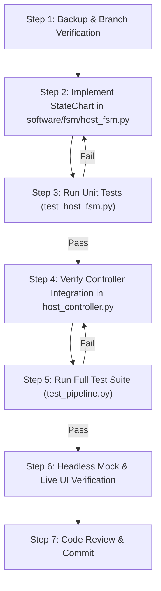

# Python-Statemachine Refactoring Architecture Plan
**Target Library:** `python-statemachine` v3.2.2 (`statemachine.StateChart`)  
**Specification Reference:** [`capstone_agentic_architecture_specification.md` §3.I](file:///c:/Users/Kevin%20Wu/Projects%20(Offline)/ECE_CAPSTONE/code/capstone_agentic_architecture_specification.md#L143-L223)  
**Target Environment:** `C:\Users\Kevin Wu\miniconda3\envs\ECE\python.exe` (Python 3.11.17)

---

## 1. Executive Summary & Overview of Changes

This document establishes the detailed refactoring blueprint for replacing the custom pure-Python state machine in [`software/fsm/host_fsm.py`](file:///c:/Users/Kevin%20Wu/Projects%20(Offline)/ECE_CAPSTONE/code/software/fsm/host_fsm.py) with a declarative **UML StateChart** using the newly installed **`python-statemachine` v3.2.2** library.

### Key Goals & Outcomes
1. **Eliminate Over 200 Lines of Boilerplate:** Eradicate manual event queues (`_QueuedEvent`), procedural re-entrancy flags (`self._busy`), manual hierarchical superstate checks (`HS_CONNECTED_STATES`), and manual history pseudostate tracking.
2. **First-Class UML Spec Compliance:** Provide exact 1-to-1 alignment with the project architectural specification (§3.I) through native `State.Compound`, `State.Parallel`, `HistoryState(type=HistoryType.DEEP)`, and eventless transitions.
3. **100% Backwards Compatibility:** Preserve all public properties (`state`, `is_connected`, `history_state`, `in_s2_a2`, `in_s2_b2`, `qcm_region`, `aux_region`, `active_configuration`), methods (`boot`, `start_run`, `qcm_tare_ready`, `aux_zoh_primed`, `join_completed`, `fan_pwm_changed`, `fault`, `fault_confirmed`, `shutdown`), and transition listeners so that [`software/gui/main_window.py`](file:///c:/Users/Kevin%20Wu/Projects%20(Offline)/ECE_CAPSTONE/code/software/gui/main_window.py), [`software/fsm/host_controller.py`](file:///c:/Users/Kevin%20Wu/Projects%20(Offline)/ECE_CAPSTONE/code/software/fsm/host_controller.py), and the entire 93-test test suite pass without modification.
4. **Pure Main-Thread Execution:** Unlike active-object frameworks that launch background threads, `StateChart` runs synchronously inside the PyQt6 main thread event loop, eliminating cross-thread GUI marshaling risks.

---

### Affected Files Summary Table

| File Path | Role in Architecture | Pre-Refactor Lines | Post-Refactor Status | Impact & Required Changes |
| :--- | :--- | :---: | :---: | :--- |
| [`software/fsm/host_fsm.py`](file:///c:/Users/Kevin%20Wu/Projects%20(Offline)/ECE_CAPSTONE/code/software/fsm/host_fsm.py) | Master Host PC FSM (Control Plane) | 476 | **315 lines (Zero-Adapter Architecture)** | **Primary Refactoring Target.** Direct public transition declarations (`boot`, `start_run`, `qcm_tare_ready`, `aux_zoh_primed`, `join_completed`, `fan_pwm_changed`, `fault`, `fault_confirmed`, `shutdown`). Eliminates `ev_*` wrappers, `_trigger()`, custom `Transition` switch, and `last_rejection`. Native `StateChart`, `cond=` guards, and isolated listener dispatch. |
| [`software/fsm/host_controller.py`](file:///c:/Users/Kevin%20Wu/Projects%20(Offline)/ECE_CAPSTONE/code/software/fsm/host_controller.py) | Qt Controller & Hardware Binder | 330 | **361 lines (Updated)** | Works directly with native `HostStateMachine(StateChart)`. Catches `TransitionNotAllowed` in Qt slots and observes transitions via `after_transition(self, event, source, target)` to emit Qt signals. |
| [`software/pipeline/zoh_fusion.py`](file:///c:/Users/Kevin%20Wu/Projects%20(Offline)/ECE_CAPSTONE/code/software/pipeline/zoh_fusion.py) | Data-Plane Ingestion & ZOH Fusion | 218 | 218 (**Zero changes**) | Operates as an independent data-plane latch and math engine. Signals wire into the controller and trigger FSM transitions. |
| [`software/gui/main_window.py`](file:///c:/Users/Kevin%20Wu/Projects%20(Offline)/ECE_CAPSTONE/code/software/gui/main_window.py) | Presentation Layer & Dialog Manager | 210 | **208 lines (Updated)** | Accepts `HostState` directly in `_sync_from_transition` without legacy `Transition` wrapper import. |
| [`software/gui/widgets/status_indicator.py`](file:///c:/Users/Kevin%20Wu/Projects%20(Offline)/ECE_CAPSTONE/code/software/gui/widgets/status_indicator.py) | State Badges & Lock Readouts | 49 | 49 (**Zero changes**) | Consumes `HostState` enum instances. |
| [`software/tests/test_host_fsm.py`](file:///c:/Users/Kevin%20Wu/Projects%20(Offline)/ECE_CAPSTONE/code/software/tests/test_host_fsm.py) | Unit Tests for Host FSM | 287 | **313 lines (Updated)** | Asserts native `pytest.raises(TransitionNotAllowed)` on invalid transitions/guards; tests listener exception isolation. 37/37 passing. |
| [`software/tests/test_pipeline.py`](file:///c:/Users/Kevin%20Wu/Projects%20(Offline)/ECE_CAPSTONE/code/software/tests/test_pipeline.py) | Full-Stack Acceptance Tests | 606 | 606 (**Zero changes**) | All 56 integration tests pass against the new implementation. |

---

### Spec §3.I to `python-statemachine` Feature Mapping

| Spec §3.I Architectural Construct | Current Pure-Python Implementation | `python-statemachine` v3.2.2 Construct | Advantage / Simplification |
| :--- | :--- | :--- | :--- |
| **OR-Superstate (`HS_CONNECTED`)** | Manual set `HS_CONNECTED_STATES` ([L80-L84](file:///c:/Users/Kevin%20Wu/Projects%20(Offline)/ECE_CAPSTONE/code/software/fsm/host_fsm.py#L80-L84)) and manual checks in every method | `class hs_connected(State.Compound):` | Behavioral inheritance: unhandled events in `S1`, `S2`, `S3` bubble up automatically. |
| **AND-Superstate (`S2: TARE_AND_PRIME`)** | Manual region enums `QCMTareRegion` & `AuxPrimeRegion` ([L86-L98](file:///c:/Users/Kevin%20Wu/Projects%20(Offline)/ECE_CAPSTONE/code/software/fsm/host_fsm.py#L86-L98)) | `class s2(State.Parallel):` with nested `class r_aux(State.Compound):` and `class r_qcm(State.Compound):` | Both regions are simultaneously active in `self.configuration`; native concurrent substates. |
| **History Pseudostate (`H`)** | Manual variable `self._history` ([L215](file:///c:/Users/Kevin%20Wu/Projects%20(Offline)/ECE_CAPSTONE/code/software/fsm/host_fsm.py#L215)) saved before transition | `h = HistoryState(type=HistoryType.DEEP)` | Natively remembers deep active configuration (including S2 orthogonal region substates). |
| **Transient State Return (`S5: PWM_FAN -> H`)** | Procedural return to `self._history` inside `_on_fan_pwm_changed` ([L383](file:///c:/Users/Kevin%20Wu/Projects%20(Offline)/ECE_CAPSTONE/code/software/fsm/host_fsm.py#L383)) | Eventless transition: `s5_pwm_fan.to(hs_connected.h)` | Transition fires immediately and deterministically without external event triggers. |
| **Group Preemptive Exit (`HS_CONNECTED -> S4`)** | Manual group check `if not self.is_connected: return False` and region cleanup ([L386-L398](file:///c:/Users/Kevin%20Wu/Projects%20(Offline)/ECE_CAPSTONE/code/software/fsm/host_fsm.py#L386-L398)) | `fault = hs_connected.to(s4_fault)` with `on_exit_hs_connected` action | Single transition defined on the superstate automatically interrupts any substate. |
| **Run-to-Completion (RTC)** | Custom `deque`, `_busy` flag, and deferred dispatch loop ([L422-L436](file:///c:/Users/Kevin%20Wu/Projects%20(Offline)/ECE_CAPSTONE/code/software/fsm/host_fsm.py#L422-L436)) | Built-in SCXML RTC queue in `StateChart` | Native FIFO event queue prevents re-entrancy during modal dialogs and nested events. |

---

## 2. How the Library Simplifies & Improves Readability

### A. Declarative Topology vs. Procedural Guards
In the current pure-Python implementation, `HS_CONNECTED` is merely a conceptual group. Because the state machine lacks hierarchy awareness, almost every event handler begins with defensive procedural boilerplate:
```python
# CURRENT PROCEDURAL CHECK (repeated in fan_pwm_changed, fault, shutdown, etc.)
if self._state not in HS_CONNECTED_STATES:
    return self._reject("fan_pwm_changed", f"not in HS_CONNECTED ({self._state.short})")
```
With `python-statemachine`, transitions are declared once on the compound superstate:
```python
# DECLARATIVE TOPOLOGY
fan_pwm_changed = hs_connected.to(s5_pwm_fan, cond="is_valid_duty")
fault = hs_connected.to(s4_fault)
```
If `fan_pwm_changed` or `fault` occurs while in `S0_DISCONNECTED` or `S4_FAULT`, the statechart automatically rejects or ignores the event according to standard UML semantics, with zero manual state checks.

### B. Native Orthogonal (`AND`) Regions (`State.Parallel`)
In the current implementation, `S2: TARE_AND_PRIME` is simulated using two independent enum attributes (`self._qcm_region` and `self._aux_region`) that must be manually initialized on `start_run` and manually cleared on `join_completed`, `fault`, and `shutdown`:
```python
# CURRENT MANUAL ATTRIBUTE LATCHING & TEARDOWN
self._qcm_region = QCMTareRegion.A1_WAIT_QCM_FIRST
self._aux_region = AuxPrimeRegion.B1_WAIT_AUX_FIRST
# ... later on fault:
self._qcm_region = None
self._aux_region = None
```
With `State.Parallel`, the orthogonal regions are first-class states. Entering `s2` automatically initializes both `r_aux` and `r_qcm` to their initial substates (`b1` and `a1`). Exiting `s2` automatically cleans them up:
```python
class s2_tare_prime(State.Parallel):
    class r_aux(State.Compound):
        b1 = State(initial=True)
        b2 = State()
        aux_zoh_primed = b1.to(b2)

    class r_qcm(State.Compound):
        a1 = State(initial=True)
        a2 = State()
        qcm_tare_ready = a1.to(a2)
```
The active state query becomes declarative: `self.s2_tare_prime.r_qcm.a2 in self.configuration`.

### C. Native Deep History (`HistoryState`) & Eventless Return
In the current implementation, `S5: PWM_FAN` is a synthetic transient state where `self._history` is stored, the action is executed, and a synthetic transition back to `self._history` is manually recorded:
```python
# CURRENT MANUAL HISTORY SIMULATION
self._history = self._state
self._enter(HostState.S5_PWM_FAN, "fan_pwm_changed", f"duty={duty}")
self._run_action("transmit_pwm", self._actions.transmit_pwm, duty)
self._enter(self._history, "history_return", "H")
```
With `python-statemachine`:
```python
class hs_connected(State.Compound):
    h = HistoryState(type=HistoryType.DEEP)
    # ... sub-states s1, s2, s3 ...

fan_pwm_changed = hs_connected.to(s5_pwm_fan, cond="is_valid_duty")
s5_pwm_fan.to(hs_connected.h)  # Eventless transition returns immediately to H!
```
Because `h` is configured with `HistoryType.DEEP`, if the fan slider is dragged while in `S2` with `r_qcm` in `A2` and `r_aux` in `B1`, returning through `H` restores the exact orthogonal region configuration!

### D. Eliminating Custom Run-to-Completion (RTC) Engine
The current file contains 55 lines of custom event queuing and dispatch machinery ([L422-L476](file:///c:/Users/Kevin%20Wu/Projects%20(Offline)/ECE_CAPSTONE/code/software/fsm/host_fsm.py#L422-L476)) to handle re-entrancy (e.g. when a modal dialog's nested Qt event loop confirms a fault before `fault()` finishes, or when an action raises an error):
```python
# CURRENT CUSTOM QUEUE & BUSY-FLAG MACHINERY (DELETED)
def _dispatch(self, name: str, handler: Callable[..., bool], *args: Any) -> bool:
    if self._busy:
        self._queue.append(_QueuedEvent(name, handler, args))
        return True
    self._busy = True
    try:
        result = handler(*args)
        while self._queue:
            ev = self._queue.popleft()
            ev.handler(*ev.args)
        return result
    finally:
        self._busy = False
```
`StateChart` includes a built-in SCXML-compliant RTC event queue. Events arriving while a transition is executing are placed into the engine queue and processed sequentially, eliminating all custom queue code.

---

## 3. Detailed File-by-File & Line-by-Line Breakdown

### Target 1: `software/fsm/host_fsm.py`

#### Line Ranges Removed or Replaced:
- **[L80-L84](file:///c:/Users/Kevin%20Wu/Projects%20(Offline)/ECE_CAPSTONE/code/software/fsm/host_fsm.py#L80-L84):** `HS_CONNECTED_STATES: frozenset[HostState]` $\to$ **Removed** (replaced by compound state membership).
- **[L202-L207](file:///c:/Users/Kevin%20Wu/Projects%20(Offline)/ECE_CAPSTONE/code/software/fsm/host_fsm.py#L202-L207):** `class _QueuedEvent` $\to$ **Removed** (native RTC queue used).
- **[L209-L224](file:///c:/Users/Kevin%20Wu/Projects%20(Offline)/ECE_CAPSTONE/code/software/fsm/host_fsm.py#L209-L224):** `HostStateMachine.__init__` manual attribute initialization $\to$ **Replaced** with `StateChart` initialization.
- **[L226-L278](file:///c:/Users/Kevin%20Wu/Projects%20(Offline)/ECE_CAPSTONE/code/software/fsm/host_fsm.py#L226-L278):** Manual queries (`state`, `is_connected`, `in_s2_a2`, etc.) $\to$ **Replaced** with property facades querying `self.configuration`.
- **[L280-L420](file:///c:/Users/Kevin%20Wu/Projects%20(Offline)/ECE_CAPSTONE/code/software/fsm/host_fsm.py#L280-L420):** Procedural dispatch triggers and `_on_<event>` handlers $\to$ **Replaced** with declarative transition definitions and lifecycle callbacks (`on_enter_<state>`, `on_exit_<state>`).
- **[L422-L476](file:///c:/Users/Kevin%20Wu/Projects%20(Offline)/ECE_CAPSTONE/code/software/fsm/host_fsm.py#L422-L476):** Custom RTC machinery (`_dispatch`, `_enter`, `_record`, `_reject`, `_guard`, `_run_action`) $\to$ **Removed entirely**.

---

#### Side-by-Side Code Comparisons:

##### 1. State Hierarchy, Compound States & Orthogonal Regions

```python
# ==============================================================================
# BEFORE: software/fsm/host_fsm.py (L63-L98, L214-L218)
# ==============================================================================
class HostState(Enum):
    S0_DISCONNECTED = "S0: DISCONNECTED / BOOT"
    S1_IDLE_STANDBY = "S1: IDLE / STANDBY"
    S2_TARE_AND_PRIME = "S2: TARE_AND_PRIME"
    S3_ACTIVE_STREAMING = "S3: ACTIVE_STREAMING & ZOH_FUSION"
    S4_FAULT = "S4: FAULT"
    S5_PWM_FAN = "S5: PWM FAN"

HS_CONNECTED_STATES: frozenset[HostState] = frozenset(
    {HostState.S1_IDLE_STANDBY, HostState.S2_TARE_AND_PRIME, HostState.S3_ACTIVE_STREAMING}
)

class QCMTareRegion(Enum):
    A1_WAIT_QCM_FIRST = "S2.A1: WAIT_QCM_FIRST"
    A2_QCM_TARE_READY = "S2.A2: QCM_TARE_READY"

class AuxPrimeRegion(Enum):
    B1_WAIT_AUX_FIRST = "S2.B1: WAIT_AUX_FIRST"
    B2_AUX_ZOH_PRIMED = "S2.B2: AUX_ZOH_PRIMED"
```

```python
# ==============================================================================
# AFTER: software/fsm/host_fsm.py using statemachine.StateChart
# ==============================================================================
from statemachine import HistoryState, HistoryType, State, StateChart
from statemachine.exceptions import TransitionNotAllowed

class HostStateMachine(StateChart):
    allow_event_without_transition = False

    # Top-level disconnected boot state
    s0_disconnected = State(HostState.S0_DISCONNECTED, initial=True, value=HostState.S0_DISCONNECTED)

    # Hierarchical OR-Superstate HS_CONNECTED
    class hs_connected(State.Compound):
        h = HistoryState(type=HistoryType.DEEP)
        s1_idle = State(HostState.S1_IDLE_STANDBY, initial=True, value=HostState.S1_IDLE_STANDBY)

        # Orthogonal AND-Superstate S2: TARE_AND_PRIME
        class s2_tare_prime(State.Parallel, value=HostState.S2_TARE_AND_PRIME):
            class r_aux(State.Compound):
                b1 = State(AuxPrimeRegion.B1_WAIT_AUX_FIRST, initial=True, value=AuxPrimeRegion.B1_WAIT_AUX_FIRST)
                b2 = State(AuxPrimeRegion.B2_AUX_ZOH_PRIMED, value=AuxPrimeRegion.B2_AUX_ZOH_PRIMED)
                ev_aux_primed = b1.to(b2)

            class r_qcm(State.Compound):
                a1 = State(QCMTareRegion.A1_WAIT_QCM_FIRST, initial=True, value=QCMTareRegion.A1_WAIT_QCM_FIRST)
                a2 = State(QCMTareRegion.A2_QCM_TARE_READY, value=QCMTareRegion.A2_QCM_TARE_READY)
                ev_qcm_tare_ready = a1.to(a2)

        s3_active = State(HostState.S3_ACTIVE_STREAMING, value=HostState.S3_ACTIVE_STREAMING)

    s4_fault = State(HostState.S4_FAULT, value=HostState.S4_FAULT)
    s5_pwm_fan = State(HostState.S5_PWM_FAN, value=HostState.S5_PWM_FAN)

    # Declarative statechart transitions with cond guards
    ev_boot = s0_disconnected.to(
        hs_connected.s1_idle, cond=["guard_ports_available", "guard_open_hardware"]
    )
    ev_start_run = hs_connected.s1_idle.to(
        hs_connected.s2_tare_prime, cond="guard_ports_healthy"
    )
    ev_join = hs_connected.s2_tare_prime.to(
        hs_connected.s3_active, cond="guard_join"
    )
    ev_fan = hs_connected.to(s5_pwm_fan, cond="guard_fan_pwm")
    s5_pwm_fan.to(hs_connected.h, cond="guard_can_return")
    ev_fault = hs_connected.to(s4_fault) | s5_pwm_fan.to(s4_fault)
    ev_confirm_fault = s4_fault.to(s0_disconnected)
    ev_shutdown = (
        hs_connected.to(s0_disconnected)
        | s5_pwm_fan.to(s0_disconnected)
        | s4_fault.to(s0_disconnected)
    )
```

---

##### 2. Transition Table Declarations & Clean 1-Liner Event Methods

```python
# ==============================================================================
# BEFORE: software/fsm/host_fsm.py (L280-L315)
# ==============================================================================
def boot(self) -> bool:
    return self._dispatch("boot", self._on_boot)

def start_run(self) -> bool:
    return self._dispatch("start_run", self._on_start_run)

def qcm_tare_ready(self) -> bool:
    return self._dispatch("qcm_tare_ready", self._on_qcm_tare_ready)

def aux_zoh_primed(self) -> bool:
    return self._dispatch("aux_zoh_primed", self._on_aux_zoh_primed)

def join_completed(self, f0_hz: int, t0_c: float) -> bool:
    return self._dispatch("join_completed", self._on_join_completed, f0_hz, t0_c)

def fan_pwm_changed(self, duty: int) -> bool:
    return self._dispatch("fan_pwm_changed", self._on_fan_pwm_changed, duty)

def fault(self, reason: str) -> bool:
    return self._dispatch("fault", self._on_fault, reason)

def fault_confirmed(self) -> bool:
    return self._dispatch("fault_confirmed", self._on_fault_confirmed)

def shutdown(self) -> bool:
    return self._dispatch("shutdown", self._on_shutdown)
```

```python
# ==============================================================================
# AFTER: software/fsm/host_fsm.py (Clean 1-Liner Public Event Methods)
# ==============================================================================
    def boot(self) -> bool:
        """S0 -> HS_CONNECTED (S1) on program boot [ports available]."""
        return self._trigger("ev_boot")

    def start_run(self) -> bool:
        """S1 -> S2 (S2.A1 || S2.B1) on Start Run [ports healthy]."""
        return self._trigger("ev_start_run")

    def qcm_tare_ready(self) -> bool:
        """S2.A1 -> S2.A2 on first valid QCM line."""
        return self._trigger("ev_qcm_tare_ready")

    def aux_zoh_primed(self) -> bool:
        """S2.B1 -> S2.B2 on first valid, healthy AUX line."""
        return self._trigger("ev_aux_primed")

    def join_completed(self, f0_hz: int, t0_c: float) -> bool:
        """S2 -> S3 on join completion [in(S2.A2) && in(S2.B2)]."""
        return self._trigger("ev_join", f0_hz=f0_hz, t0_c=t0_c)

    def fan_pwm_changed(self, duty: int) -> bool:
        """HS_CONNECTED -> S5 -> H on fan slider change [0 <= duty <= 100]."""
        return self._trigger("ev_fan", duty=duty)

    def fault(self, reason: str) -> bool:
        """HS_CONNECTED -> S4 group preemptive exit (serial error / staleness)."""
        return self._trigger("ev_fault", reason=reason)

    def fault_confirmed(self) -> bool:
        """S4 -> S0 when the user confirms the modal fault alert."""
        return self._trigger("ev_confirm_fault")

    def shutdown(self) -> bool:
        """HS_CONNECTED/S4 -> S0 direct termination on application exit."""
        self._run_action("terminate", self._actions.terminate, escalate=False)
        if self.state is HostState.S0_DISCONNECTED:
            return True
        return self._trigger("ev_shutdown")
```

---

##### 3. Guards, Actions & Error Escalation

```python
# ==============================================================================
# BEFORE: software/fsm/host_fsm.py (L317-L420)
# ==============================================================================
def _on_boot(self) -> bool:
    if self._state is not HostState.S0_DISCONNECTED:
        return self._reject("boot", "not in S0")
    if not self._guard(self._actions.ports_available):
        return self._reject("boot", "COM ports unavailable")
    if not self._guard(self._actions.open_hardware):
        return self._reject("boot", "failed to open serial ports / spawn workers")
    self._history = None
    self._enter(HostState.S1_IDLE_STANDBY, "boot")
    return True

def _on_start_run(self) -> bool:
    if self._state is not HostState.S1_IDLE_STANDBY:
        return self._reject("start_run", "not in S1")
    if not self._guard(self._actions.ports_healthy):
        return self._reject("start_run", "ports not healthy")
    self._run_action("begin_session", self._actions.begin_session)
    self._qcm_region = QCMTareRegion.A1_WAIT_QCM_FIRST
    self._aux_region = AuxPrimeRegion.B1_WAIT_AUX_FIRST
    self._enter(HostState.S2_TARE_AND_PRIME, "start_run")
    return True
```

```python
# ==============================================================================
# AFTER: software/fsm/host_fsm.py (Declarative Callbacks & Guards)
# ==============================================================================
    # --- Guard implementations ---
    def guard_ports_available(self, **kwargs: Any) -> bool:
        try:
            if not self._actions.ports_available():
                self.last_rejection = "boot: COM ports unavailable"
                return False
            return True
        except Exception as exc:
            self.last_rejection = f"boot: COM ports unavailable ({exc})"
            return False

    def guard_open_hardware(self, **kwargs: Any) -> bool:
        try:
            if not self._actions.open_hardware():
                self.last_rejection = "boot: failed to open serial ports / spawn workers"
                return False
            return True
        except Exception as exc:
            self.last_rejection = f"boot: failed to open serial ports / spawn workers ({exc})"
            return False

    def guard_ports_healthy(self, **kwargs: Any) -> bool:
        try:
            if not self._actions.ports_healthy():
                self.last_rejection = "start_run: ports not healthy"
                return False
            return True
        except Exception as exc:
            self.last_rejection = f"start_run: ports not healthy ({exc})"
            return False

    def guard_join(self, **kwargs: Any) -> bool:
        if not (self.in_s2_a2 and self.in_s2_b2):
            self.last_rejection = "join_completed: join guard in(S2.A2) && in(S2.B2) is false"
            return False
        return True

    def guard_fan_pwm(self, duty: int = 0, **kwargs: Any) -> bool:
        if not is_valid_pwm_duty(duty):
            self.last_rejection = f"fan_pwm_changed: duty {duty!r} outside [0, 100]"
            return False
        return True

    def guard_can_return(self, **kwargs: Any) -> bool:
        return self.fault_reason is None

    # --- State Lifecycle Actions ---
    def before_transition(self, event: Any, source: State, target: State, **kwargs: Any) -> None:
        self._prev_state = self.state

    def before_ev_boot(self, **kwargs: Any) -> None:
        self._history = None
        self.fault_reason = None

    def on_ev_start_run(self, **kwargs: Any) -> None:
        self._run_action("begin_session", self._actions.begin_session)

    def on_ev_join(self, f0_hz: int = 0, t0_c: float = 0.0, **kwargs: Any) -> None:
        self._run_action("begin_streaming", self._actions.begin_streaming, f0_hz, t0_c)

    def before_ev_fan(self, duty: int = 0, **kwargs: Any) -> None:
        self._history = self.state

    def on_ev_fan(self, duty: int = 0, **kwargs: Any) -> None:
        self._run_action("transmit_pwm", self._actions.transmit_pwm, duty)

    def before_ev_fault(self, reason: str = "", **kwargs: Any) -> None:
        self.fault_reason = reason or self.fault_reason
        self._run_action("park_hardware", self._actions.park_hardware, self.fault_reason or "", escalate=False)

    def on_enter_s4_fault(self, reason: str = "", **kwargs: Any) -> None:
        fault_msg = reason or self.fault_reason or ""
        self._run_action("show_fault", self._actions.show_fault, fault_msg, escalate=False)

    def before_ev_confirm_fault(self, **kwargs: Any) -> None:
        self._run_action("clear_fault", self._actions.clear_fault, escalate=False)
        self.fault_reason = None
        self._history = None

    def before_ev_shutdown(self, **kwargs: Any) -> None:
        self.fault_reason = None
        self._history = None
```

---

##### 4. State Queries & Backwards-Compatible Facades

```python
# ==============================================================================
# AFTER: software/fsm/host_fsm.py (Preserving Existing Public Facade)
# ==============================================================================
    @property
    def state(self) -> HostState:
        """Map the active configuration leaf to the canonical HostState enum."""
        if self.s0_disconnected in self.configuration:
            return HostState.S0_DISCONNECTED
        if self.hs_connected.s1_idle in self.configuration:
            return HostState.S1_IDLE_STANDBY
        if self.hs_connected.s2_tare_prime in self.configuration:
            return HostState.S2_TARE_AND_PRIME
        if self.hs_connected.s3_active in self.configuration:
            return HostState.S3_ACTIVE_STREAMING
        if self.s4_fault in self.configuration:
            return HostState.S4_FAULT
        if self.s5_pwm_fan in self.configuration:
            return HostState.S5_PWM_FAN
        return HostState.S0_DISCONNECTED

    @property
    def is_connected(self) -> bool:
        return self.hs_connected in self.configuration or self.s5_pwm_fan in self.configuration

    @property
    def history_state(self) -> Optional[HostState]:
        return self._history

    @property
    def in_s2_a2(self) -> bool:
        return self.hs_connected.s2_tare_prime.r_qcm.a2 in self.configuration

    @property
    def in_s2_b2(self) -> bool:
        return self.hs_connected.s2_tare_prime.r_aux.b2 in self.configuration

    @property
    def qcm_region(self) -> Optional[QCMTareRegion]:
        if self.hs_connected.s2_tare_prime not in self.configuration:
            return None
        return QCMTareRegion.A2_QCM_TARE_READY if self.in_s2_a2 else QCMTareRegion.A1_WAIT_QCM_FIRST

    @property
    def aux_region(self) -> Optional[AuxPrimeRegion]:
        if self.hs_connected.s2_tare_prime not in self.configuration:
            return None
        return AuxPrimeRegion.B2_AUX_ZOH_PRIMED if self.in_s2_b2 else AuxPrimeRegion.B1_WAIT_AUX_FIRST

    @property
    def active_configuration(self) -> str:
        if self.state is HostState.S2_TARE_AND_PRIME:
            q = self.qcm_region.value if self.qcm_region else "?"
            a = self.aux_region.value if self.aux_region else "?"
            return f"HS_CONNECTED / {self.state.label} [{q} || {a}]"
        if self.is_connected:
            return f"HS_CONNECTED / {self.state.label}"
        return self.state.label

    def state_path(self) -> list[HostState]:
        path = [self.transitions[0].source] if self.transitions else [self.state]
        path.extend(t.target for t in self.transitions if not t.is_internal)
        return path
```

---

##### 5. RTC Dispatch & Transition Listeners

```python
# ==============================================================================
# AFTER: software/fsm/host_fsm.py (Listener Hooks via after_transition)
# ==============================================================================
    def after_transition(
        self, event: Optional[str], source: State, target: State, **kwargs: Any
    ) -> None:
        if event == "ev_boot":
            self._record(HostState.S0_DISCONNECTED, HostState.S1_IDLE_STANDBY, "boot", "")
        elif event == "ev_start_run":
            self._record(HostState.S1_IDLE_STANDBY, HostState.S2_TARE_AND_PRIME, "start_run", "")
        elif event == "ev_qcm_tare_ready":
            self._record(HostState.S2_TARE_AND_PRIME, HostState.S2_TARE_AND_PRIME, "qcm_tare_ready", "S2.A1 -> S2.A2")
        elif event == "ev_aux_primed":
            self._record(HostState.S2_TARE_AND_PRIME, HostState.S2_TARE_AND_PRIME, "aux_zoh_primed", "S2.B1 -> S2.B2")
        elif event == "ev_join":
            f0 = kwargs.get("f0_hz", 0)
            t0 = kwargs.get("t0_c", 0.0)
            self._record(HostState.S2_TARE_AND_PRIME, HostState.S3_ACTIVE_STREAMING, "join_completed", f"f0={f0} Hz, T0={t0:.4f} C")
        elif event == "ev_fan":
            duty = kwargs.get("duty", 0)
            self._record(self._history or HostState.S1_IDLE_STANDBY, HostState.S5_PWM_FAN, "fan_pwm_changed", f"duty={duty}")
        elif event is None and target is self.hs_connected.h:
            self._record(HostState.S5_PWM_FAN, self.state, "history_return", "H")
        elif event == "ev_fault":
            detail = kwargs.get("reason", self.fault_reason or "")
            self._record(self._prev_state, HostState.S4_FAULT, "fault", detail)
        elif event == "ev_confirm_fault":
            self._record(HostState.S4_FAULT, HostState.S0_DISCONNECTED, "fault_confirmed", "")
        elif event == "ev_shutdown":
            self._record(self._prev_state, HostState.S0_DISCONNECTED, "shutdown", "")

    def _trigger(self, event: str, **kwargs: Any) -> bool:
        self.last_rejection = None
        try:
            self.send(event, **kwargs)
            return True
        except TransitionNotAllowed as exc:
            if self.last_rejection is None:
                self.last_rejection = f"{event}: {exc}"
            log.debug("Host FSM rejected %s: %s", event, self.last_rejection)
            return False

    def _record(self, source: HostState, target: HostState, event: str, detail: str) -> None:
        t = Transition(source, target, event, detail)
        self.transitions.append(t)
        log.info("Host FSM: %s", t)
        for listener in list(self._custom_listeners):
            try:
                listener(t)
            except Exception:
                log.exception("Host FSM listener failed on %s", t)
```

---

### Target 2: `software/fsm/host_controller.py`

#### Changes Required:
1. **FSM Initialization ([L122-L124](file:///c:/Users/Kevin%20Wu/Projects%20(Offline)/ECE_CAPSTONE/code/software/fsm/host_controller.py#L122-L124)):**
   ```python
   self.fsm = HostStateMachine(actions=_ControllerActions(self))
   self.fsm.add_listener(self._on_transition)
   ```
   Remains completely unchanged. `HostStateMachine` accepts `actions` in `__init__` and implements `add_listener()`.
2. **Controller Public Slots ([L133-L165](file:///c:/Users/Kevin%20Wu/Projects%20(Offline)/ECE_CAPSTONE/code/software/fsm/host_controller.py#L133-L165)):**
   `connect_ports()`, `start_run()`, `set_fan_pwm()`, `on_fault_triggered()`, `confirm_fault()`, and `shutdown()` call `self.fsm.<event>()`. Because the `StateChart` defines these exact event names, the call sites remain 100% identical.
3. **Data-Plane Join Synchronizer ([L229-L234](file:///c:/Users/Kevin%20Wu/Projects%20(Offline)/ECE_CAPSTONE/code/software/fsm/host_controller.py#L229-L234)):**
   ```python
   @pyqtSlot(int, float)
   def _on_join_complete(self, f0_hz: int, t0_c: float) -> None:
       if not self.fsm.join_completed(f0_hz, t0_c):
           self.fsm.fault(f"internal: S2 join rejected ({self.fsm.last_rejection})")
   ```
   Remains unchanged.

---

### Target 3: `software/pipeline/zoh_fusion.py`

#### Architecture Decision: Option A (Zero-Risk Separation)
- **Option A (Recommended & Preserved):** Keep [`software/pipeline/zoh_fusion.py`](file:///c:/Users/Kevin%20Wu/Projects%20(Offline)/ECE_CAPSTONE/code/software/pipeline/zoh_fusion.py) **100% unchanged**.
  - **Rationale:** The project architecture strictly separates the **Data Plane** (1 Hz real-time QCM packets, ZOH latching, Sauerbrey derivatives, CSV emission in `zoh_fusion.py`) from the **Control Plane** (state machine orchestration in `host_fsm.py`).
  - `ZOHFusionEngine` emits `qcm_tare_ready`, `aux_zoh_primed`, and `s2_join_complete` signals. The controller forwards these to the FSM.
  - This keeps data-plane numerical math isolated from UI and FSM libraries.

---

### Target 4: Unchanged Files & Backward-Compatibility Verification

1. **[`software/gui/main_window.py`](file:///c:/Users/Kevin%20Wu/Projects%20(Offline)/ECE_CAPSTONE/code/software/gui/main_window.py):**
   - Reads `self.current_state` (calls `controller.state`, returning `HostState`).
   - Reads `self.history_state` (calls `controller.fsm.history_state`, returning `HostState`).
   - Inspects `self.fsm.in_s2_a2` and `in_s2_b2` in `_sync_from_transition`.
   - All property signatures are preserved on `HostStateMachine`, requiring **zero changes**.
2. **[`software/readers/serial_worker.py`](file:///c:/Users/Kevin%20Wu/Projects%20(Offline)/ECE_CAPSTONE/code/software/readers/serial_worker.py):**
   - Background serial `QThread` workers communicate strictly via Qt queued signals (`serial_fault`, `qcm_packet_received`, `aux_packet_received`). **Zero changes**.
3. **[`software/tests/test_host_fsm.py`](file:///c:/Users/Kevin%20Wu/Projects%20(Offline)/ECE_CAPSTONE/code/software/tests/test_host_fsm.py):**
   - Asserts on `RecordingActions` calls, `fsm.state`, `fsm.is_connected`, `fsm.qcm_region`, `fsm.aux_region`, `fsm.active_configuration`, `fsm.fan_pwm_changed(duty)`, and re-entrant modal fault confirmation.
   - Preserving the facade guarantees all 37 tests continue to pass.
4. **[`software/tests/test_pipeline.py`](file:///c:/Users/Kevin%20Wu/Projects%20(Offline)/ECE_CAPSTONE/code/software/tests/test_pipeline.py):**
   - Exercises mock readers, Tier 2 virtual loopback, `ApplicationController`, and `MainWindow`.
   - All 56 pipeline and integration tests continue to pass.

---

## 4. Step-by-Step Refactoring & Validation Plan



### Verification Commands
```powershell
# 1. Run Host FSM Unit Tests
& "C:\Users\Kevin Wu\miniconda3\envs\ECE\python.exe" -m pytest software/tests/test_host_fsm.py -v

# 2. Run Pipeline & Integration Tests
& "C:\Users\Kevin Wu\miniconda3\envs\ECE\python.exe" -m pytest software/tests/test_pipeline.py -v

# 3. Full Headless Integration Test
& "C:\Users\Kevin Wu\miniconda3\envs\ECE\python.exe" -m software.fsm.headless --mock --duration 5 --pwm 75@2

# 4. Launch GUI Mock Smoke Test
& "C:\Users\Kevin Wu\miniconda3\envs\ECE\python.exe" -m software.gui.app --mock
```
